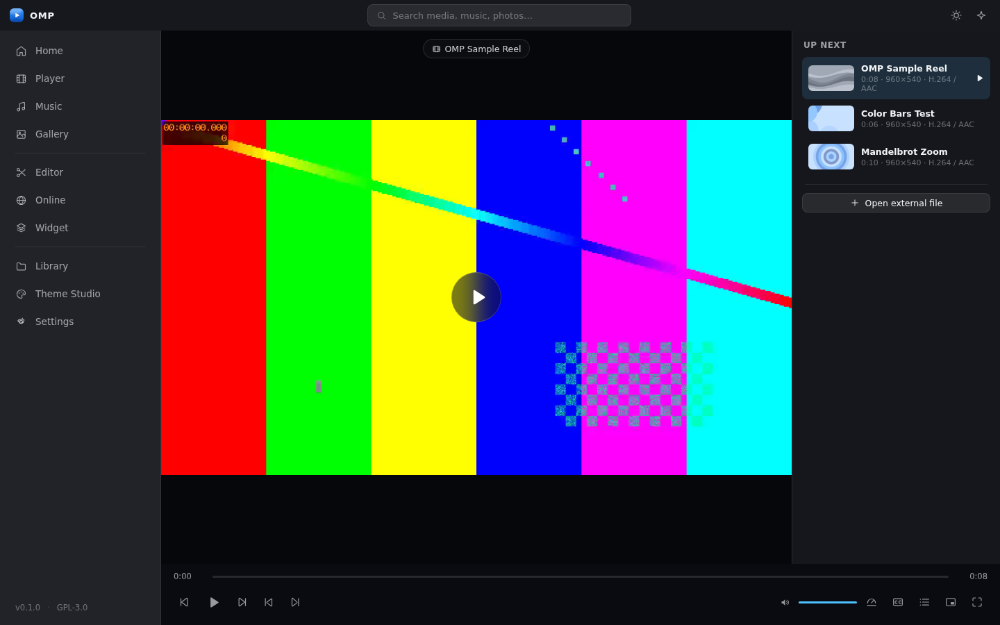

# OMP — Open Media Player

**Every Format. One Player. Open to All.**

OMP is a custom-built, lightweight Windows media platform. It owns the interface
and application experience, and reuses proven media engines (mpv, FFmpeg,
libvips) for playback and processing — so effort goes into what makes OMP
distinctive, not into reinventing video decoding.



## Highlights

- **Universal playback** — video & music, playlists, subtitles (SRT/WebVTT),
  playback speed, frame stepping, multiple audio tracks, optional hardware
  acceleration, software-decoding fallback.
- **Windows 10 & 11, tuned separately** — Mica on Windows 11, Acrylic on
  Windows 10, explicit runtime detection, plus a Reduced Effects mode.
- **Gallery & library** — images, folders, thumbnails, search, metadata, zoom,
  rotation, slideshows. Incremental, cancellable scans that never stall playback.
- **Lightweight editor** — trim, crop, shapes, arrows, text, keyframes,
  undo/redo, editable `.ompj` projects, FFmpeg-based export.
- **Music & desktop widget** — album artwork, playlists, radio, and a floating
  player that works with the main window closed.
- **Online media** — dedicated YouTube experience, authorized IPTV and radio.
  No OMP-inserted ads, ever.
- **Theme Studio** — dark/light/system, five tasteful accents, adjustable
  transparency, Reduced Effects for low-end PCs.

## What's new in v0.9.0 — the engine that always starts + built-in YouTube

- **The engine loader is now defensive end to end.** On some machines a
  foreign DLL that merely shares the name `mpv-2.dll` was loaded first and
  trusted blindly — no mpv exports, engine dead, and every downstream
  feature (videos, IPTV, radio, thumbnails) silently broken while Settings
  said "DLL found but did not initialise". Every loader candidate is now
  symbol-verified before acceptance, the bundled `resources\mpv-2.dll` is
  tried FIRST, and rejected modules are freed and skipped. If the full
  tuned option set is refused, the engine retries with a bare minimum set
  before giving up — and the exact failure reason lands in diagnostics.
- **Built-in YouTube — no API key needed.** OMP now bundles yt-dlp: search
  YouTube out of the box (Settings → Online shows the extractor status),
  and when the native engine is healthy, pasted links and search results
  play **natively in OMP** — hardware decoded, VLC-grade controls, a
  fraction of the WebView embed's CPU. The embed remains as fallback with
  a one-click "Native player" upgrade button.
- **All-format URL support.** The same extractor teaches mpv YouTube,
  Twitter/X, TikTok, Instagram, Vimeo, Twitch VODs, Bilibili, SoundCloud
  and 1000+ other sites — paste any link, OMP plays it. Formats are capped
  at 1080p with h264 preferred so hardware decode engages on every GPU.
- **Video previews that never depend on the engine.** Library thumbnails,
  durations, resolutions and tags now fall back to the bundled FFmpeg when
  mpv probing is unavailable — previews work on every machine.
- **YouTube links can no longer spin the demuxer.** Without the extractor,
  YouTube URLs are refused cleanly instead of being fed to mpv as raw HTML.
- **Diagnostics that actually explain.** The engine card and Copy
  diagnostics now include the full loader attempt trail (which file was
  accepted, rejected, or refused and why) plus the extractor state.

## What's new in v0.8.1 — the audio-chain fix round

- **Track-switch chaos: root cause removed.** mpv fires an end-of-file event
  for *ordinary* transitions (pressing Stop, switching to the next song).
  Those were surfacing as errors — every track change showed a fake
  "Playback failed" toast and armed an auto-skip that machine-gunned through
  the queue. Only real decode errors are errors now; Stop and track switches
  are silent and instant.
- **No more zombie playback.** If the engine dies mid-song the UI now says
  so — and pressing play rebuilds the engine with the current track instead
  of doing nothing.
- **No more double audio.** The built-in fallback engine can no longer keep
  playing underneath the native engine after "Re-test engine".
- **Radio that heals.** A dropped station stream auto-reconnects once
  (throttled) and then stops honestly — never a fake ON AIR again.
- **Copy diagnostics** — one button in Settings → Playback copies the exact
  engine + audio session state as text, so a bug report pinpoints the broken
  leg instantly.

## What's new in v0.8.0 — Phase 5: online media

- **Dedicated YouTube experience.** Paste any YouTube link (watch, shorts,
  youtu.be, live, embed, or playlist) and it plays instantly in a theater
  embed — no account, no key. Optional search uses **your own** free YouTube
  Data API key (10,000 units/day from Google): results show real thumbnails,
  durations, channels and view counts. Everything runs on YouTube's official
  nocookie embed player — authorized interfaces only, no scraping, and your
  key stays local.
- **IPTV that actually plays.** Import standard **M3U / M3U8** playlists (the
  format every IPTV provider exports), browse channels with logos and group
  filters, and streams open through the **native mpv engine** — HLS, TS and
  direct HTTP streams decode with the same pipeline as your local files.
  Nothing runs in the background when you stop watching. Playlists can also be
  opened by double-click (.m3u / .m3u8 are now registered OMP file types).
- **Radio is real.** The Online → Radio tab now drives the same engine session
  as the Music screen: the four curated stations, your custom stations, live
  ICY "now playing" titles, stop/add/remove — and the desktop widget follows
  along.
- **YouTube Music tab** — music-scoped search (same optional key) plus a
  one-click jump to the official YouTube Music in your browser.
- **Bundled ≠ loaded** — the whole Online screen is code-split and only
  downloads when you first visit it; the main window stays lean.
- **Built-in public channels** — NASA TV and Red Bull TV ship preconfigured,
  legal and free, so Live TV works out of the box.

## What's new in v0.7.0 — Phase 4: the lightweight editor

- **Real editing, same engine.** The Editor screen now loads any video OMP can
  play (MKV, HEVC, AVI, WebM, MP4…) and previews it through the native mpv
  engine — scrub, trim, annotate on the real picture, not a proxy.
- **Trim** with a scrubbable timeline: drag the selection, the preview loops
  inside it, exports only the kept range.
- **Crop** with corner handles over the full frame; the preview, overlays and
  the export all agree on the crop window.
- **Timed overlays** — rectangles, circles, arrows and text with color, stroke
  and font controls. Each overlay has an in/out point on the keyframe lane, so
  annotations appear exactly when you place them (set in/out at the playhead
  with one click).
- **Undo / redo** — Ctrl+Z / Ctrl+Y (40 steps) across every edit.
- **Projects as .ompj** — JSON project files, auto-saved locally, reopenable
  from the app or by double-click (.ompj is now a registered OMP file type).
- **True FFmpeg export** — MP4 (H.264 + AAC, three quality presets), WebM
  (VP9 + Opus) and animated GIF (palette-optimized) with live progress and a
  real cancel (kills the encoder). Overlays are burned in pixel-perfect via
  pre-rendered PNG frames, so the export matches the preview exactly.
- **Diagnostics** — Settings shows the bundled FFmpeg exporter status and path.

## What's new in v0.6.2 — music that always plays + widget 2.0

- **Music bulletproofed at the engine root.** Three stacked causes found and
  fixed: (1) the libmpv core was initialised with mpv's default `idle=no` —
  an empty core **shuts itself down immediately**, so audio sessions could be
  born dead before the first song ever loaded (`idle=yes` now); (2) audio
  attaches used to build the *video* pipeline too (child HWND + embedded
  surface + GPU video output) — audio now runs **surface-less** (`vo=null`,
  no HWND), so machines whose video path fails can still play every audio
  format, and audio/video sessions cleanly rebuild the engine when they
  take over from each other; (3) when the engine core dies, the stale
  instance now un-registers itself so the next play re-attaches instead of
  failing forever.
- **A music engine that cannot die.** If libmpv is missing or blocked on
  your machine (antivirus quarantine is the #1 cause), OMP no longer gives
  up: the built-in WebView audio engine takes over automatically and plays
  your files through the asset protocol — same queue, shuffle, repeat,
  desktop widget and progress. A toast tells you when it happens, and
  **Settings → Playback → Re-test engine** re-probes the DLL after you fix
  the cause (no restart needed).
- **Engine errors are now words, not silence.** Failed attaches carry the
  exact reason (`mpv_initialize failed: …`) to toasts and diagnostics, the
  Win32 load-error codes got human hints (5 = antivirus, 126 = blocked DLL,
  193 = wrong arch, 1114 = GPU runtime), and playback errors mid-file no
  longer freeze the UI on a fake "playing" state — you get a toast and an
  auto-skip to the next track.
- **Windows media keys + media overlay.** Title, artist and cover art now
  surface in the Windows media flyout, and your keyboard's media keys
  (play/pause/next/previous) control OMP.
- **Widget 2.0.** Tap any queue row to jump to that track, shuffle and
  repeat toggles, double-click the artwork to bring OMP back, a CSS-only
  playing indicator (zero timers, zero CPU when paused) and **position
  memory** — the widget reopens exactly where you dragged it, clamped so it
  can never get lost off-screen.
- **More translucent, less work.** Dark-theme surfaces and the widget card
  got lighter alpha layers (airier glass), and the panel blur dropped its
  `saturate()` pass — same look, cheaper compositing. The audio broadcast
  to the widget no longer re-sends the whole queue at the 4 Hz progress
  tick (queue travels only when it changes).

## What's new in v0.6.1 — the bug-fix round

- **Desktop widget: fixed.** The widget window was created inside a
  *synchronous* command — on Windows that deadlocks the event loop (the
  builder waits for the loop, the loop waits for the command): the widget
  came up white/frozen and could take the app with it. Window creation is
  now an async command per the Tauri contract. The native drop shadow is
  off (it also drew a 1 px white border on frameless windows) and the card
  dropped its `backdrop-filter` — the blur sampled the whole desktop on
  every compositor frame and made **dragging feel slow and glitchy**. The
  widget now drags butter-smooth.
- **Music: no more silent failures.** An HTMLAudioElement can't play a raw
  filesystem path, so the old web fallback inside the app meant "playing"
  with zero sound. The audio service now verifies the engine attach result
  (with one retry), checks the `mpv_load` result, and surfaces a real error
  toast instead of pretending. **Settings → About → Engine diagnostics**
  shows the exact engine state — DLL path, libmpv version, and the raw
  Windows error code if the DLL refuses to load (antivirus quarantine and
  missing GPU runtimes are the usual culprits).
- **Previews everywhere.** The Gallery now reads **real scanned images**
  (jpg/png/webp/bmp/gif/avif/tiff) from the library database — every photo
  in your scanned folders shows as a live thumbnail with the lightbox
  viewer (rescan your folders once to index images). Album art and video
  thumbnails now use the correct per-platform asset URL — the hand-rolled
  `asset://` links silently 404'd on Windows WebView2.
- **Default player.** OMP now registers file associations for videos,
  music and images at install time — right-click any media file →
  *Open with → OMP*, or hit Settings → Playback → Default apps to set it
  system-wide. Double-clicking more files goes to the running app
  (single-instance), and files passed at launch open instantly: video →
  Player, audio → Music, image → Gallery.
- **The Playlists tab is real.** The Library screen's Playlists tab now
  manages the actual SQLite playlists (create, view tracks, remove items,
  delete, play) instead of demo cards.
- **Rounder, tighter UI** — cards, panels, chips and menus got the full
  Fluent radius treatment (Windows 10 keeps its tighter corners).

## What's new in v0.6.0 — Phase 3: Music & widgets

- **The real music library** — every audio file OMP scans gets its embedded
  album art extracted to a JPEG (mpv decodes the cover track exactly like a
  video thumbnail), and ID3/FLAC/Vorbis tags (artist · album · genre) land in
  SQLite. The Music screen groups albums with real covers, searches across
  tags, and remembers per-track progress and play counts.
- **SQLite playlists** — create playlists, add tracks from any track's
  right-click menu, play or delete them from the Music screen. Stored in the
  same library database, resolved live against your files.
- **Internet radio** — five built-in stations (SomaFM, Radio Paradise), one
  click to play via the native engine, **live "now playing" titles** streamed
  from the station's ICY metadata, and add-your-own stream URL (right-click a
  custom station to remove it).
- **A real desktop widget** — a frameless, translucent, always-on-top second
  window: artwork, title, seek bar, transport controls; expands to show the
  queue and volume. Drag it anywhere by its header.
- **Background playback** — close the main window while music plays and OMP
  keeps going: the window hides, the widget pops up, the music never stops.
  Quit from the widget menu when you're done (toggle in Settings →
  Background playback).
- **Engine as a global service** — audio sessions survive navigation (and
  window close); opening a video politely offers "Stop & play video" instead
  of silently hijacking your music.

## What's new in v0.5.0 — the ultra-light engine fix (CPU 70% → done)

Three stacked causes were burning CPU during playback, and all three are now
fixed at the root:

- **The window material fought the video.** OMP's Mica (Win11) / Acrylic
  (Win10) blur-behind stayed attached while the native mpv surface played
  video *underneath* the transparent webview — so Windows recomposited a
  full-window blur on every single video frame. The material now detaches
  the moment playback attaches and returns when it ends. The glass look is
  untouched on every non-playing screen.
- **Glass blur sampled the live video.** Any `backdrop-filter` panel whose
  backdrop included the transparent video tunnel was recomputed per frame.
  All backdrop blurs are now suspended engine-wide while `mpv-live` is
  active (panels switch to their solid surfaces).
- **Silent software decode.** `hwdec=auto-safe` refuses hardware decode on
  non-whitelisted GPU/driver combos and falls back to CPU decoding without
  telling anyone. The engine now requests `hwdec=auto`, adds software-decode
  fast paths (`vd-lavc-fast`, skip-loopfilter) as a safety net, and — most
  importantly — **Stats for nerds (press `I`) now shows the live decode
  path**: `hardware · d3d11va` in green, or an explicit amber
  "software (slower — enable HW accel in Settings)" warning. Nothing is
  silent anymore.

Also in v0.5.0: the stats overlay reports the active renderer, container and
rendered FPS, dropped frames, A/V sync offset and bitrate (probed on demand
at 1 Hz *only while the overlay is open* — zero idle timers, per spec).

## What's new in v0.4.0 — bulletproof installer + the real SQLite library (Phase 2)

- **Fixed: the installer that couldn't install** — v0.3's setup could fail with
  `error writing to file resources\mpv-2.dll` when OMP was still running (or the
  antivirus briefly held the 116 MB engine DLL). A half-installed OMP then ran
  on the heavy WebView fallback — which is exactly why CPU looked *worse*
  (60–70%) after "upgrading". The v0.4 installer force-closes OMP first,
  waits for file handles to release, and retries locked files before
  extracting. Upgrading over any old version now just works.
- **Engine health check** — if the native engine is ever missing from an
  install, Settings says so explicitly instead of silently falling back.
- **Phase 2: the real media library (SQLite)** — point OMP at a folder and it
  builds a searchable, sortable library stored in a local SQLite database:
  * **Real scanner** — walks your folders (with a skip list for system dirs),
    indexes video + audio, prunes vanished files. **Incremental** (unchanged
    files are skipped by size+mtime), **cancellable** (Cancel scan button),
    and **paced on a background thread** so playback never stutters.
    Zero disk activity while idle — nothing scans unless you ask.
  * **Thumbnails** — extracted with a throwaway headless libmpv instance that
    decodes exactly one frame at ~25% into the file. No extra downloads, no
    background churn.
  * **Metadata** — duration, resolution, video/audio codec and container come
    from the same engine that plays your files, so what you see is what plays.
  * **Library UI** — poster grid with duration/quality badges and watch
    progress bars, Continue Watching strip, A–Z / Newest / Recently played /
    Longest / Most played sorting, type filters, folder chips with one-click
    removal, full right-click menus (Play / Resume / Play from start / Open
    file location / Remove).
  * **Resume everywhere** — positions are saved to SQLite for both engines and
    playback resumes where you left off, including files you simply "Open
    with" OMP (they get indexed automatically).
  * **Live storage stats** — Settings shows videos / tracks / thumbnails /
    folders counts from the real database.

## What's new in v0.3.0 — the native mpv engine

- **VLC-grade CPU, for real this time** — OMP now embeds **libmpv** (the same
  engine core mpv/VLC-class players use) as the native playback engine. Video
  decodes with hardware acceleration (D3D11VA) and renders on its own GPU
  surface *below* the transparent UI — measured CPU for normal playback drops
  from ~30-37% (WebView path) to a small fraction of that on the same files.
- **Color adjustments no longer eat the PC** — brightness / contrast /
  saturation / hue are now mpv GPU shader properties (~0% extra CPU) instead of
  CSS filters that forced Chromium to re-process every single frame (the 48.5%
  spike). On the WebView fallback engine the filter is now only applied when a
  value is actually changed from neutral.
- **Every format. Really.** — the bundled GPL libmpv decodes MKV, HEVC/H.265,
  AVI, WMV, FLV, TS, and more, with auto-loaded external subtitles
  (`sub-auto=fuzzy`) and multi-track audio/subtitle menus. The engine streams
  HTTP(S) media natively too.
- **Engine selector** — Settings → Playback engine: Auto (default, uses mpv
  when present), mpv (force native), WebView (compatibility fallback). Stats
  for nerds shows the live engine and libmpv API version.
- **WebView engine still improved** — title chip auto-hides while playing and
  the mouse is idle (windowed too, not just fullscreen), PiP and web-only
  controls are gated per engine, and the UI stops paying for transitions while
  frames are playing.
- **Sane plumbing** — native file dialogs now hand real filesystem paths to
  mpv; snapshots save natively to Pictures\\OMP; the surface tracks the stage
  rect across resizes, fullscreen and DPI changes; the engine shuts down
  cleanly on exit.

## What's new in v0.2.0 — VLC-grade control

- **Fixed: dead timeline** — the seek bar now uses a proper scrub state
  machine (drag, click, keyboard — no more snap-back), plus hover time
  preview and a buffered-progress bar. Sources served without HTTP Range
  support (which made Chromium collapse the seekable range to zero and
  reject every seek) are auto-upgraded to a fully seekable blob copy.
- **Fixed: ~30% CPU during playback** — the boot splash now unmounts
  instead of running an invisible infinite animation forever, and
  backdrop-blur was removed from layers rendered on top of video frames.
- **Right-click everywhere** — full VLC-style context menu on the video
  (speed, jump, aspect, zoom, rotate, adjustments, delays, loop, snapshot,
  stats…), plus menus on the queue, Home cards, history, music and photos.
- **Cinema sidebar** — the navigation sidebar hides itself while video
  plays and peeks back from the left edge (toggle in Settings).
- **30+ hotkeys** — Space/K, J/L, 0–9, Ctrl+G, B (A-B loop), T (snapshot),
  Z (rotate), +/- zoom, [ ] speed, G/H & Alt+J/K delays, Q, I, Shift+L, R…
  Press <kbd>?</kbd> anywhere for the full map.
- **VLC staples** — A-B loop, loop off/all/one, shuffle, snapshot to PNG,
  aspect ratio & zoom & rotation, brightness/contrast/saturation/hue,
  subtitle & audio delay, volume boost to 200%, stats-for-nerds overlay,
  jump-to-time, real queue management (reorder/remove/add from anywhere),
  auto-hiding fullscreen controls and VLC-style OSD feedback.

## Tech stack

| Component        | Technology                     |
| ---------------- | ------------------------------ |
| Desktop shell    | Tauri 2                        |
| Frontend         | React + TypeScript + Vite      |
| Native backend   | Rust                           |
| Video processing | FFmpeg + FFprobe (Phase 4)     |
| Images           | libvips (Phase 2)              |
| Database         | SQLite (Phase 2)               |
| Project format   | JSON-based `.ompj` (Phase 4)   |
| Online playback  | YouTube nocookie embeds + bundled yt-dlp → native mpv (1000+ sites) |

## Development

```bash
npm install
npm run tauri dev      # desktop app (requires Rust + Windows for full effects)
npm run dev            # frontend only, in the browser
npm run build          # typecheck + production web build
npm run tauri build    # Windows installer (NSIS + MSI)
```

## Architecture rules

1. **Own playback adapter** — native mpv integration lives in a dedicated Rust
   module; playback commands never scatter across the frontend. Phase 1 ships
   WebView2 playback (H.264/AAC/WebM) with the adapter seam already in place
   for libmpv.
2. **Bundled ≠ loaded** — heavy components ship but stay out of the runtime
   until needed. The editor, online WebView, advanced image processing and
   Theme Studio are lazy.

## Releases

Windows installers are built automatically by GitHub Actions on every `v*` tag
and published on the [Releases page](https://github.com/kakadon000/omp/releases/latest).

## License

[GPL-3.0-or-later](LICENSE). Every public release includes dependency notices
and build information. OMP itself contains no advertising and no tracking.
